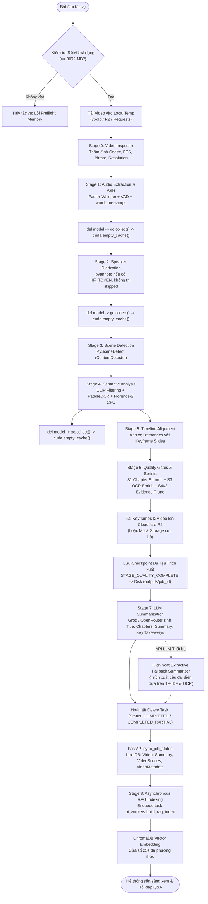
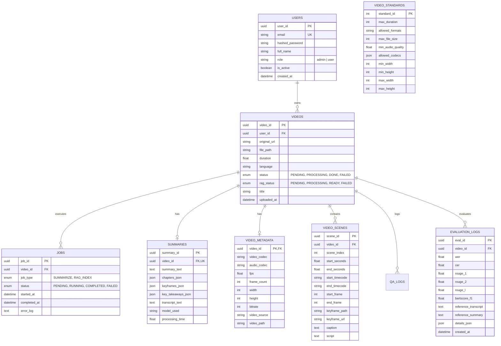

# Kiến Trúc Hệ Thống Hiện Tại (Current System Architecture)
## Multimodal Lecture Summarizer

Tài liệu này phản ánh **chính xác kiến trúc, luồng xử lý và chi tiết triển khai thực tế** của hệ thống **Multimodal Lecture Summarizer** dựa trên toàn bộ mã nguồn của codebase hiện tại (Backend FastAPI, Frontend React Vite, và AI Workers Celery).

---

## 1. Tổng quan Hệ thống (System Overview)

Multimodal Lecture Summarizer là nền tảng xử lý, phân tích và tóm tắt bài giảng video đa phương thức (kết hợp âm thanh, hình ảnh trình chiếu, nhận dạng chữ OCR và mô hình ngôn ngữ lớn). Hệ thống hoạt động theo mô hình dịch vụ phân tán, xử lý bất đồng bộ định hướng hàng đợi tác vụ.

### Các thành phần chính:

| Thành phần | Công nghệ | Vai trò trong hệ thống |
|---|---|---|
| **Frontend Web App** | React 18, Vite, TypeScript, TailwindCSS, Lucide Icons | Giao diện người dùng: Upload video, thẩm định trước tệp (Preflight Modal), xem video đồng bộ timeline/slide, xem tóm tắt & key takeaways, hỏi đáp RAG, quản trị tiêu chuẩn video và dashboard đánh giá benchmark. |
| **Backend API** | FastAPI (Python 3.10/3.11), Uvicorn, Pydantic v2 | Cung cấp RESTful API (`/api/v1/`), chuẩn hóa phản hồi (`BaseDTO`), xác thực người dùng JWT, quản lý CSDL SQLAlchemy ORM, điều phối Celery Task, và chạy background worker định kỳ đồng bộ trạng thái tác vụ. |
| **Task Queue & Broker** | Celery 5.x, Redis | Hàng đợi tác vụ phân tán. Điều phối các pipeline AI nặng (`process_video`, `build_rag_index`), hỗ trợ hủy tác vụ an toàn (cooperative cancellation) và khôi phục từ checkpoint. |
| **AI Workers** | PyTorch, Faster-Whisper, pyannote.audio (tuỳ chọn), PySceneDetect, PaddleOCR, Florence-2, CLIP | Worker chạy pipeline trích xuất đa phương thức tuần tự. Pyannote chỉ chạy khi có `HF_TOKEN`. |
| **Relational Database** | PostgreSQL (Production) / SQLite (Dev), Alembic | Lưu trữ dữ liệu quan hệ: người dùng, video, siêu dữ liệu kỹ thuật video, phân cảnh (scenes), tóm tắt & trích đoạn, nhật ký Q&A, tiêu chuẩn kỹ thuật video và log đánh giá benchmark. |
| **Vector Database** | ChromaDB (Cloud / HTTP / In-memory Fallback) | Lưu trữ các vector nhúng (embeddings) từ các đoạn trích đa phương thức phục vụ truy vấn ngữ nghĩa cho tính năng Hỏi đáp (RAG Chat). |
| **Object Storage** | Cloudflare R2 / AWS S3 (qua `boto3`) | Lưu trữ tệp video nguồn tải về từ YouTube và các ảnh khung hình chính (keyframes/slides) đã bóc tách. Có cơ chế fallback lưu trữ cục bộ (Mock Storage). |
| **External LLMs** | Groq API (`llama-3.1-8b-instant`), OpenRouter | Sinh bản tóm tắt phân cấp, tiêu đề bài giảng và danh sách điểm cốt lõi (Key Takeaways). Khi LLM gặp sự cố, hệ thống tự động kích hoạt bộ tóm tắt trích xuất dự phòng (Extractive Fallback). |

---

### Sơ đồ Kiến trúc Tổng thể (High-Level Architecture)

```mermaid
flowchart TD
    Client["Frontend UI (React + Vite)"] -->|REST API Requests / JWT| API["FastAPI Backend (/api/v1)"]
    
    API -->|CRUD Queries| DB[("PostgreSQL / SQLite")]
    API -->|Query Embeddings| Chroma[("ChromaDB Vector Store")]
    API -->|Enqueue Task| Redis[("Redis Broker & Result Backend")]
    
    subgraph Celery_Worker ["Celery AI Worker (ai_workers)"]
        direction TB
        TaskProc["ai_workers.process_video"]
        TaskRAG["ai_workers.build_rag_index (Decoupled)"]
        
        TaskProc --> Preflight["1. Memory & Video Standards Preflight"]
        Preflight --> AudioPipe["2. Audio ASR & Speaker Diarization"]
        AudioPipe --> VisualPipe["3. Scene Detect & Keyframe Extraction"]
        VisualPipe --> SemanticPipe["4. Semantic Analysis (CLIP, OCR, Florence-2)"]
        SemanticPipe --> FusionPipe["5. Timeline Alignment & Quality Sprints"]
        FusionPipe --> Checkpoint["6. Checkpoint Persistence (Disk)"]
        Checkpoint --> SummarizePipe["7. LLM Summarization / Extractive Fallback"]
        
        SummarizePipe -.->|Save Result & Trigger| API
    end
    
    Redis -->|Dispatch Task| Celery_Worker
    API -.->|Poll Progress (10s Loop)| Redis
    TaskRAG -->|Push Multimodal Chunks| Chroma
    TaskProc -->|Upload Video & Keyframes| R2[("Cloudflare R2 Storage")]
```

---

## 2. Cấu trúc Tổ chức Thư mục Repo Thực tế

Không giống các bản phác thảo ban đầu, kiến trúc mã nguồn hiện tại được phân chia rõ ràng theo từng domain chuyên biệt:

```
multimodal-lecture-summarizer/
├── backend/                       # FastAPI REST API Backend
│   ├── alembic/                   # Database migrations scripts
│   ├── app/
│   │   ├── api/v1/                # Route handlers (auth, videos, jobs, summaries, qa, stats, evaluation, users)
│   │   ├── core/                  # Cấu hình Pydantic, database engine, JWT security, hằng số (constants)
│   │   ├── models/                # SQLAlchemy Models (video, summary, job, user, evaluation)
│   │   ├── schemas/               # Pydantic Schemas & Data Transfer Objects (DTO)
│   │   └── services/              # Business services (chromadb, video_inspector, evaluation_service)
│   ├── requirements.txt           # Dependencies cho Backend
│   └── tests/                     # Unit & Integration tests cho API
│
├── frontend/                      # React 18 + TypeScript Web Application
│   ├── src/
│   │   ├── components/            # UI components (VideoPreflightModal, EvaluationBenchmarkView, CorrelationWidget, ...)
│   │   ├── pages/                 # Pages (UploadPage, ResultsPage, AdminPage, EvaluationBenchmarkPage)
│   │   ├── services/api.ts        # Axios API client chuẩn hóa gọi Backend
│   │   ├── types/index.ts         # TypeScript interfaces & DTOs
│   │   └── utils/videoValidator.ts# Client-side video probe & validation
│   └── package.json
│
├── ai_workers/                    # Celery Worker xử lý tác vụ AI nặng
│   ├── core/                      # Celery app instance, checkpoint manager, resource cleanup
│   ├── modules/
│   │   ├── audio_v2/              # Faster-Whisper transcriber; pyannote chỉ khi có HF_TOKEN
│   │   ├── visual_v2/             # Scene detector (PySceneDetect) & Semantic analyzer (CLIP, PaddleOCR, Florence-2)
│   │   ├── fusion/                # Timeline alignment builder & Quality postprocess (Sprint stack S1-S10)
│   │   └── summarization/         # LLM client, prompt templates, error handling, Extractive fallback summarizer
│   ├── tasks.py                   # Các Celery Tasks: process_video, build_rag_index, subtasks
│   └── requirements.txt           # Khóa cố định transformers==4.57.6, torch, whisperx, ...
│
├── benchmarks/                    # Khung benchmark, manifest và ground-truth tham chiếu
├── experiments/                   # Notebooks & scripts nghiên cứu thực nghiệm (RQ1-RQ4, EDA, ablation)
├── docs/                          # Tài liệu kiến trúc, hướng dẫn triển khai, báo cáo thực nghiệm
├── outputs/                       # Artifact theo job. Checkpoint nằm ở storage/checkpoints/
├── storage/                       # Local Mock Storage (khi không bật Cloudflare R2)
├── docker-compose.yml             # Docker compose định nghĩa Redis, PostgreSQL, Backend, Frontend
├── run_win.ps1 / run.bat          # Bộ launcher PowerShell / Batch tự động hóa trên Windows
└── run.sh                         # Bộ launcher cho Linux
```

---

## 3. Quy trình Xử lý Video Đầu - Cuối (End-to-End Processing Pipeline)

Toàn bộ chu trình trích xuất và phân tích chạy tuần tự thông qua Celery task chính `ai_workers.process_video`.

### Biểu đồ Luồng Phụ thuộc Tuần tự (Sequential Execution Graph)



---

### Chi tiết Từng Chặng Xử lý (Stage Breakdown)

#### 0. Preflight & Thẩm định Tiêu chuẩn Video (Stage 0)
- **Kiểm tra Bộ nhớ RAM**: `ensure_process_memory_available` kiểm tra lượng RAM trống thực tế của hệ điều hành. Nếu dưới 3072 MB, tác vụ sẽ tạm dừng thử lại (retry); nếu vẫn không đủ, hủy tác vụ trước khi nạp model để tránh crash OOM tiến trình.
- **Tải tệp & Video Inspector**: Tải video về thư mục cục bộ thông qua `yt-dlp` (đối với liên kết YouTube) hoặc `boto3` (nếu trên R2).
- **Thẩm định Kỹ thuật**: `inspect_video_streams` phân tích chi tiết luồng video qua FFprobe. Hệ thống truy vấn bảng `video_standards` để kiểm tra độ dài tối đa, định dạng cho phép, codec hợp lệ (ví dụ: `h264`, `hevc`), độ phân giải nằm trong khoảng `[min_width, min_height]` đến `[max_width, max_height]`.

#### 1. Xử lý Âm thanh & Nhận dạng Giọng nói (Stage 1: Audio & ASR)
- **Mô hình**: Faster-Whisper, mặc định `small`, có mốc thời gian từng từ. Không dùng forced alignment.
- **Ngôn ngữ**: `source_language` là `auto`, `vi` hoặc `en`, đi từ form upload tới `transcribe()`. `auto` không ép ngôn ngữ. `output_language` chỉ chọn ngôn ngữ bản tóm tắt.
- **Cơ chế**: Trích xuất WAV 16kHz mono, chạy VAD và word timestamps của Faster-Whisper.
- **Dọn dẹp**: WAV được xóa sau stage, kể cả video upload local. Model được giải phóng bằng `release_worker_resources("audio stage")`.

#### 2. Phân biệt Người nói (Stage 2: Speaker Diarization)
- **Mô hình**: pyannote `speaker-diarization-3.1` chỉ khi biến `HF_TOKEN` có giá trị.
- **Không có token**: `diarization_status=skipped`. Transcript giữ nguyên, không gán `SPEAKER_00`.
- **Có token**: gán speaker có overlap lớn nhất. Overlap dưới 30% thì `UNKNOWN`. Lỗi model ghi `diarization_status=failed` và không làm fail cả pipeline.

#### 3. Phát hiện Phân cảnh Video (Stage 3: Visual Scene Detection)
- **Mô hình**: `PySceneDetect` (thuật toán `ContentDetector` kết hợp ngưỡng thích ứng).
- **Nhiệm vụ**: Quét toàn bộ video để phát hiện các lát cắt chuyển cảnh (cut boundaries), trích xuất khung hình khóa đại diện cho mỗi phân cảnh (keyframe slide) và lưu ra đĩa.

#### 4. Phân tích Ngữ nghĩa Khung hình (Stage 4: Semantic Analysis)
- **Lọc trùng lặp**: Trích xuất vector đặc trưng hình ảnh bằng CLIP ViT-B/32, phân cụm bằng K-Means để loại bỏ các slide trùng hoặc chỉ chuyển động nhẹ của người thuyết trình.
- **Nhận dạng chữ (OCR)**: Chạy `PaddleOCR` trên các slide đại diện để trích xuất toàn bộ văn bản bài giảng, công thức, đề mục hiển thị trên slide.
- **Sinh mô tả ảnh (Captioning)**: Sử dụng mô hình `Florence-2-base` (chạy trên chế độ CPU/FP32/eager nhằm đảm bảo tính tái lập 100% giữa Windows và Linux, tránh hiện tượng sinh token rác). Tự động bỏ qua captioning nếu RAM hệ thống khả dụng nhỏ hơn 6144 MB.

#### 5. Đồng bộ Trục thời gian (Stage 5: Timeline Alignment)
- **Mô hình**: `TimelineBuilder`.
- **Nhiệm vụ**: Kết hợp chuỗi câu thoại (có timestamp và speaker ID) với dòng thời gian xuất hiện của từng slide/keyframe. Phát hiện các điểm dịch chuyển chủ đề (topic shift) để sinh các mốc phân đoạn chương mục ban đầu (chapters).

#### 6. Lớp Tối ưu Chất lượng (Stage 6: Quality Gates & Sprint Stack)
Áp dụng bộ xử lý tinh chỉnh `apply_quality_postprocess`:
- **Sprint 1 (Smooth Chapters)**: Hợp nhất các chương mục quá ngắn (< 45 giây) vào chương liền kề để tạo mục lục mượt mà, dễ theo dõi.
- **Sprint 3 (Enrich Captions with OCR)**: Bổ sung ngữ nghĩa chữ viết từ PaddleOCR vào mô tả trực quan của slide.
- **Sprint 4_v2 (Evidence-aware Keyframe Prune)**: Lọc bỏ các keyframe dư thừa, chỉ giữ lại các slide mang nội dung bài học cốt lõi tương ứng với từng chương.
- **Anti-Hallucination Gate**: Đảm bảo tuyệt đối không có luồng nào cho phép transcript ghi đè làm giả trường visual description của keyframe.

#### 7. Lưu trữ Checkpoint Dữ liệu (Intermediate Checkpoint Persistence)
- Trước khi gọi LLM, `CheckpointManager` ghi `storage/checkpoints/{job_id}.json`. File gồm `source_sha256`, `config_fingerprint` (model ASR, ngôn ngữ nguồn, Florence device, sprint stack, pipeline version) và `payload_sha256`.
- Checkpoint bị từ chối khi hash file nguồn hoặc fingerprint cấu hình không khớp. File mồ côi bị xóa sau 7 ngày. Checkpoint hợp lệ được xóa sau khi tóm tắt thành công.
- Nếu LLM lỗi sau khi checkpoint đã lưu và file nguồn chưa đổi, worker có thể tiếp tục từ stage `quality_complete`.

#### 8. Tóm tắt Đa phương thức & Extractive Fallback (Stage 7: Summarization)
- **Mô hình chính**: Gọi LLM tốc độ cao qua Groq (`llama-3.1-8b-instant`) hoặc OpenRouter (`Summarizer` / `LLMClient`).
- **Nội dung sinh ra**:
  1. Tiêu đề video chuẩn hóa (`video_title`).
  2. Bản tóm tắt tổng thể có cấu trúc Markdown phân cấp rõ ràng theo chương mục.
  3. Cập nhật tiêu đề và tóm tắt ngắn cho từng chapter.
  4. Danh sách các điểm cốt lõi bài học (`key_takeaways`).
- **Khả năng tự phục hồi (Extractive Fallback)**: Nếu LLM bị lỗi mạng, vượt hạn mức (Rate limit 429) hoặc timeout, `ExtractiveFallbackSummarizer` tự động kích hoạt: tính trọng số TF-IDF kết hợp OCR để trích xuất các câu phát biểu quan trọng nhất của bài giảng làm tóm tắt, gắn cờ `fallback_used = True` và chuyển trạng thái hoàn tất một phần (`completed_partial`). Tác vụ của người dùng **không bao giờ bị crash hoàn toàn**.

#### 9. Đánh Chỉ mục RAG Đa phương thức Bất đồng bộ (Stage 8: Decoupled RAG)
- Không còn chặn đồng bộ trong tiến trình xử lý video. Khi tác vụ hoàn tất, FastAPI chuyển trạng thái `rag_status` của video sang `PROCESSING` (sử dụng atomic compare-and-set) và đẩy một Celery task riêng biệt: `ai_workers.build_rag_index`.
- Phân mảnh dữ liệu theo cửa sổ trượt ~25 giây. Mỗi chunk tích hợp:
  `[MM:SS] Lời giảng: <transcript> | Văn bản trên slide: <ocr> | Mô tả hình ảnh: <caption>`
- Mỗi chunk giữ lời giảng, OCR, caption, đối tượng và `keyframe_url`. `rag_status` chỉ thành `ready` khi số chunk đọc lại khớp. `POST /qa` trả 409 khi trạng thái khác `ready`.

---

## 4. Quản lý Trạng thái & Cơ chế Đồng bộ (Job Lifecycle & State Sync)

### 1. Đồng bộ Trạng thái Phía Backend
FastAPI không tạo kết nối WebSocket liên tục gây tốn tài nguyên worker, mà áp dụng cơ chế **Eventual Consistency kết hợp Polling định kỳ**:
- Luồng ngầm `poll_celery_jobs` chạy mỗi 10 giây trong tiến trình Backend.
- Hàm `sync_job_status(job, db)` truy vấn trực tiếp trạng thái AsyncResult từ Redis backend của Celery:
  - Nếu Celery ở trạng thái `PROGRESS`: Trích xuất `meta` (`stage`, `progress`, `logs`) và cập nhật vào model `Job` trong CSDL.
  - Nếu Celery ở trạng thái `SUCCESS`: Mở một transaction cơ sở dữ liệu lớn để lưu toàn bộ thực thể: cập nhật `Video` (duration, title, file_path), tạo bản ghi `Summary` (kèm `key_takeaways_json`), tạo các dòng `VideoScene`, cập nhật `VideoMetadata`, và kích hoạt background task `build_rag_index`.
  - Nếu Celery ở trạng thái `FAILURE`: Cập nhật `JobStatus.FAILED` kèm log lỗi để người dùng dễ tra cứu.

### 2. Cơ chế Hủy tác vụ Hợp tác (Cooperative Cancellation)
- Khi người dùng bấm Cancel trên giao diện UI, Backend gọi `celery_app.control.revoke(task_id, terminate=True)`.
- Bên trong Celery task, hàm chốt chặn `check_revoked()` được đặt ở đầu mỗi stage. Khi phát hiện state `REVOKED`, task sẽ tự động giải phóng tài nguyên cục bộ và dừng lại ngay lập tức, không để lại tiến trình zombie trên hệ điều hành Windows/Linux.

---

## 5. Thiết kế Cơ sở Dữ liệu & Mô hình Dữ liệu (Entity Relationship)

Hệ thống sử dụng SQLAlchemy 2.0 ORM với định kiểu chặt chẽ (Mapped types):



---

## 6. Kiến trúc Multimodal RAG & Chat Q&A

Tính năng hỏi đáp tài liệu bài giảng cho phép người học đặt câu hỏi tự nhiên về nội dung video.

1. **Embedding Model**: Sử dụng mô hình chuẩn của ChromaDB (`sentence-transformers/all-MiniLM-L6-v2`) hoặc nhúng tùy biến.
2. **Cấu trúc lưu trữ Chunk**:
   ```
   [Thời gian: 05:20] 
   Lời giảng: "Hôm nay chúng ta sẽ tìm hiểu về cơ chế Self-Attention trong Transformer..."
   Văn bản trên slide: "Attention Is All You Need (Vaswani et al., 2017). Formula: Softmax(QK^T / sqrt(d_k))V"
   Mô tả trực quan: "Biểu đồ minh họa phép nhân ma trận Query, Key và Value."
   ```
3. **Luồng Truy vấn (`POST /api/v1/qa/ask`)**:
   - Nhận câu hỏi từ học viên và `video_id`.
   - ChromaDB thực hiện Similarity Search (Cosine distance) lấy Top-K (mặc định $K=4$) đoạn trích phù hợp nhất.
   - Kết hợp các đoạn trích ngữ cảnh cùng lịch sử hội thoại gần nhất vào Prompt mẫu của RAG.
   - Gọi LLM (Groq / OpenRouter) sinh câu trả lời kèm trích dẫn thời gian và đường dẫn hình ảnh keyframe minh chứng.
4. **Cơ chế Fallback Khi Mất Kết Nối ChromaDB**:
   - Nếu máy chủ ChromaDB không phản hồi (`is_chromadb_responsive` kiểm tra cổng HTTP thất bại), hệ thống tự động kích hoạt `mock_store` (bộ lưu trữ vector tạm trong RAM) để giữ cho giao diện hỏi đáp không bị ngắt quãng.

---

## 7. Phân hệ Đánh giá Thực nghiệm & Thống kê Hiệu năng (Evaluation & Stats)

Kiến trúc tích hợp sẵn hai phân hệ đo lường khoa học:

### 1. Phân hệ Đánh giá Benchmark (`/api/v1/evaluation`)
- Hỗ trợ tải các bộ dữ liệu đối chuẩn (TED-LIUM cho ASR/Summary, TVSum cho Scene/Keyframe).
- Ghi nhận và trực quan hóa các chỉ số:
  - **ASR**: Word Error Rate (WER), Character Error Rate (CER), Real-Time Factor (RTF).
  - **Scene / Keyframe**: Precision, Recall, F1-Score.
  - **Summary**: ROUGE-1, ROUGE-2, ROUGE-L, BERTScore F1.
- Giao diện `EvaluationBenchmarkView.tsx` cho phép so sánh song song giữa mô hình đang chạy thực tế (Production) và các mô hình ứng viên (Candidates).

### 2. Phân hệ Phân tích Tương quan Hiệu năng (`/api/v1/stats`)
- Tính toán hệ số tương quan tuyến tính (**Pearson**) và phi tuyến (**Spearman**) giữa các biến đầu vào của video và độ trễ xử lý:
  - Tương quan giữa **Thời lượng video** và **Thời gian xử lý từng stage**.
  - Ảnh hưởng của **Độ phân giải & Bitrate** tới tốc độ phân tích thị giác (Scene / OCR / Florence-2).
  - Ảnh hưởng của **Chất lượng âm thanh** tới độ chính xác ASR.
- Trực quan hóa trực tiếp trên `AdminPage` thông qua `PerformanceCorrelationWidget`.

---

## 8. Quản trị Tài nguyên & Chiến lược Tối ưu Phần cứng (Resource Management)

Do tính chất pipeline tích hợp nhiều mô hình Deep Learning lớn trên máy phát triển đơn GPU, hệ thống áp dụng các nguyên tắc kỹ thuật nghiêm ngặt:

1. **Thực thi Tuần tự Tuyệt đối (Strict Sequential Execution)**:
   - Các pipeline Âm thanh và Thị giác **không chạy song song**.
   - Sau Stage 1 (Faster-Whisper), model được xóa khỏi bộ nhớ và VRAM được giải phóng bằng `release_worker_resources()` trước khi nạp model thị giác.
2. **Khóa Ổn định Florence-2 trên CPU (Deterministic CPU Contract)**:
   - Do thư viện mã nguồn mở của Florence-2 dễ gặp hiện tượng sinh token rác trên môi trường GPU hoặc Transformers phiên bản mới, hệ thống chuẩn hóa:
     - Khóa phiên bản `transformers==4.57.6`.
     - Ép buộc Florence-2 chạy ở chế độ **CPU / Float32 / Eager Attention / Seed cố định**.
     - Đạt được độ ổn định và kết quả tái lập tuyệt đối 100% trên cả Windows và Linux.
3. **Bảo vệ Bộ nhớ Đệm (Memory Guard & Thresholds)**:
   - Ngưỡng sàn khởi động tác vụ: **3072 MB** RAM khả dụng.
   - Ngưỡng cho phép chạy Florence-2: **6144 MB** RAM khả dụng (dưới ngưỡng này sẽ bỏ qua captioning, chỉ sử dụng OCR và CLIP để bảo vệ worker).
   - Thiết lập `expandable_segments:True` cho `PYTORCH_CUDA_ALLOC_CONF` nhằm giảm thiểu phân mảnh bộ nhớ VRAM.

---

## 9. Bảng Đối chiếu: Ý tưởng Ban đầu vs Hiện thực Codebase

| Khía cạnh | Thiết kế Ban đầu (Cũ / Phác thảo) | Kiến trúc Triển khai Thực tế Hiện tại |
|---|---|---|
| **Cấu trúc Source** | Dự kiến dạng CLI đơn lẻ `src/mls/` | Hệ thống phân tán: `backend/` (FastAPI), `frontend/` (React), `ai_workers/` (Celery) |
| **Thực thi Pipeline** | Đề xuất chạy song song Audio và Visual | Chạy **tuần tự tuyệt đối** nhằm bảo vệ VRAM GPU dưới 12GB |
| **Xử lý LLM Lỗi** | Mất toàn bộ tiến trình nếu LLM rớt mạng | **Checkpoint persistence** lưu trạng thái trung gian + **Extractive Fallback** tự động |
| **Đánh chỉ mục RAG** | Chạy đồng bộ trong pipeline video chính | **Tách biệt bất đồng bộ** thành Celery task riêng (`build_rag_index`) |
| **Thẩm định Video** | Không có thẩm định codec trước | **Video Inspector** kiểm tra chuẩn codec/resolution trước khi cho phép chạy |
| **Mô hình Caption** | Đề xuất BLIP-2 / LLaVA GPU | **Florence-2-base** chuẩn hóa CPU/FP32 deterministic chống sinh token rác |
| **Giao diện Người dùng** | Giao diện cơ bản | Dashboard hiện đại: Video Preflight, Player đồng bộ Slide, Benchmark & Correlation charts |

---

*Tài liệu này được cập nhật đầy đủ và chuẩn xác theo mã nguồn nhánh `feat/update-project` mới nhất của dự án.*
